<div align="center">

# Allure — music streaming platform

**A full-stack SoundCloud-style web app for uploading, discovering and listening to music.**

Diploma project · React 19 + TypeScript on the frontend, ASP.NET Core (.NET 10) + PostgreSQL on the backend.


<!-- TODO(author): add the live demo link when it is deployed -->
**[Live demo](#)** · **[Figma design](https://www.figma.com/design/nfIpdVHfxZWBvBx0G7EqNu/Allure-main--Copy---Copy-?node-id=0-1)** · **[API docs (Swagger, local)](http://localhost:5122/swagger)**

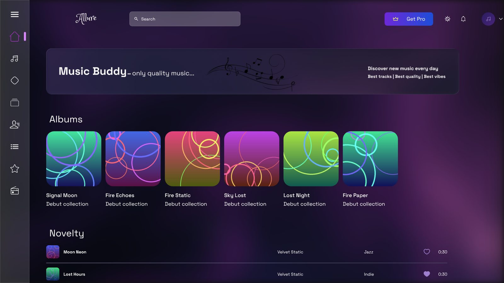

</div>

## Table of contents

- [About](#about)
- [Features](#features)
- [Screenshots](#screenshots)
- [Tech stack](#tech-stack)
- [Architecture](#architecture)
- [Repository structure](#repository-structure)
- [Getting started](#getting-started)
- [Configuration](#configuration)
- [API overview](#api-overview)
- [Security notes](#security-notes)
- [Roadmap](#roadmap)
- [Author](#author)

## About

**Allure** is a music streaming platform inspired by SoundCloud. Artists upload their tracks, group them into albums and playlists, and build an audience through likes and followers. Listeners browse the catalog by genre, artist and chart, and play music in a persistent player that keeps working while they navigate the site.

The UI follows the **Allure** design created in Figma (dark purple theme, glass panels, custom typography). The goal of the project is a production-like full-stack application: a typed React SPA, a REST API with JWT authentication and role-based access, a relational database with migrations, and file storage for audio and images.

<!-- TODO(author): one or two sentences about the diploma: university, faculty, specialty, year, supervisor -->
> This repository is the practical part of a diploma (graduation) project. _University, specialty and year: to be added._

## Features

**Listening**
- Persistent bottom player: play / pause, previous / next, seek, repeat, volume, queue, like from the player
- Play counts and listening statistics per track and per author
- Track, album, artist and genre detail pages with "You might like" recommendations

**Discovery**
- Home page with new albums and latest tracks ("Novelty")
- Catalog pages: Music, Albums, Mood & genres, Artists, Charts, Top 100, Top of the year
- Search with live suggestions
- Radio page (UI ready, streams are placeholders)

**Creating and sharing**
- Upload tracks (audio + cover + genre) and attach them to albums
- Create albums and playlists with covers, add / remove tracks
- User profile with avatar, banner and bio; public profiles of other users
- Likes ("Favorite" page), follow / unfollow, followers and following lists

**Accounts**
- Registration and login with email and password (JWT)
- Google sign-in (OAuth, Google ID token validated on the server)
- Password recovery by email (forgot / reset password)
- "Get Pro" subscription page with plans and promo code (UI, no real payments)
- Light / dark theme toggle

**Administration** (role-based: `User`, `Moderator`, `Admin`)
- Manage users: change role, block / unblock, edit, delete
- Moderate tracks (hide / restore), manage albums, playlists, genres and categories

## Screenshots

| Landing | Login |
|---|---|
| 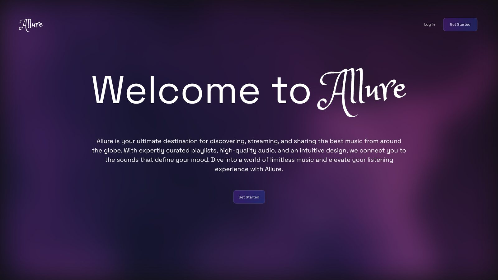 | 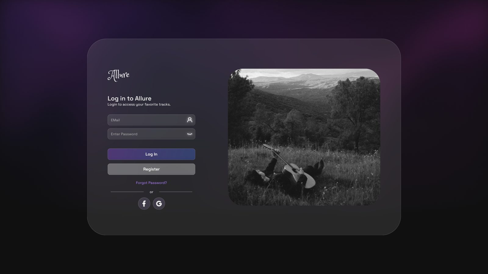 |
| **Music + player** | **Mood & genres** |
| 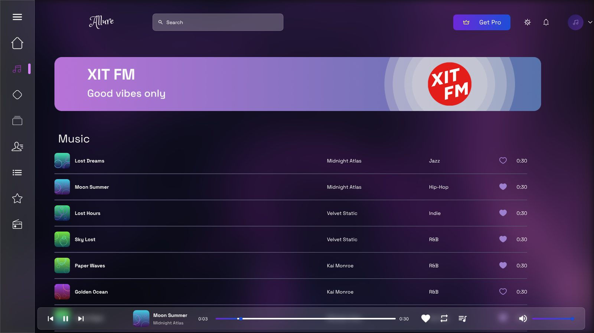 | 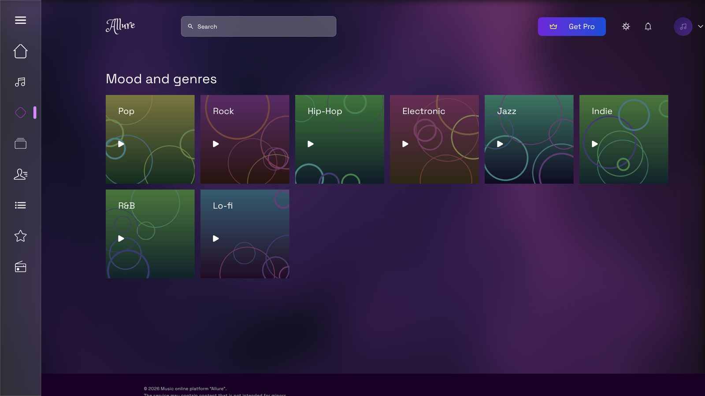 |
| **Artists** | **Charts** |
| 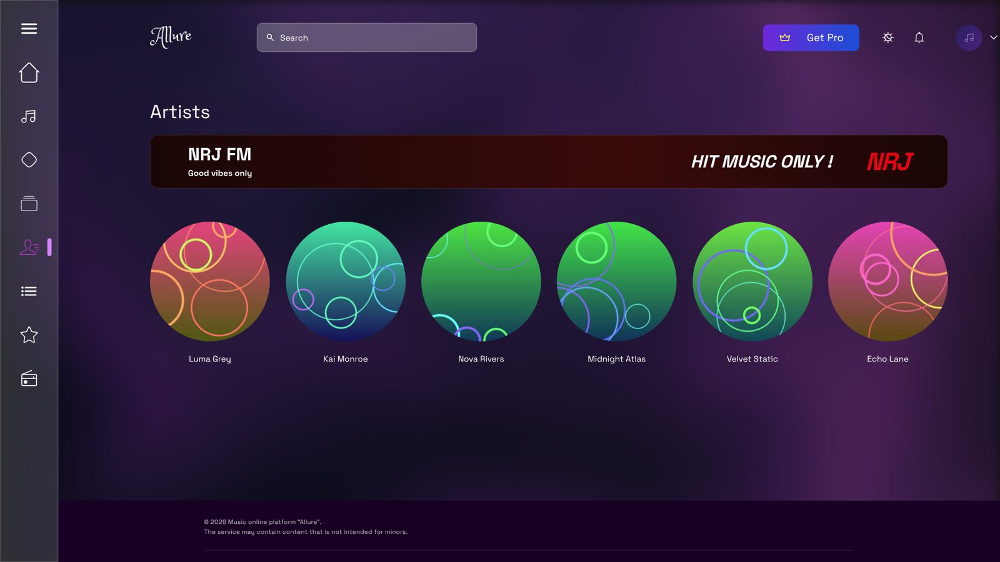 | 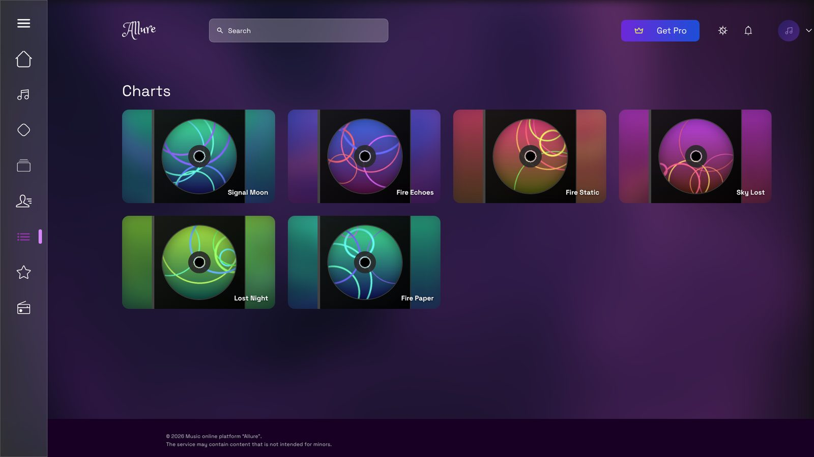 |
| **Album** | **Track** |
| 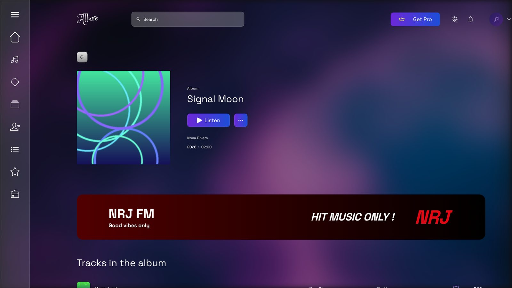 | 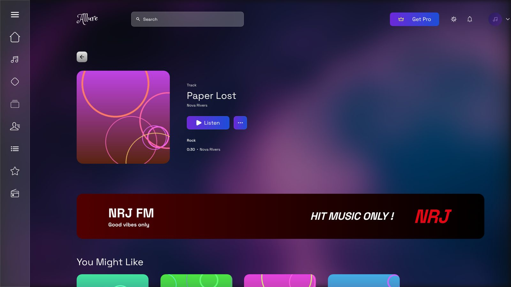 |
| **Radio** | **Get Pro** |
| 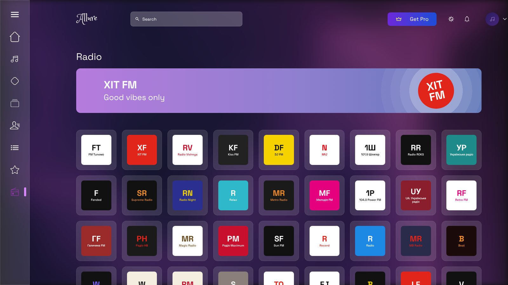 | 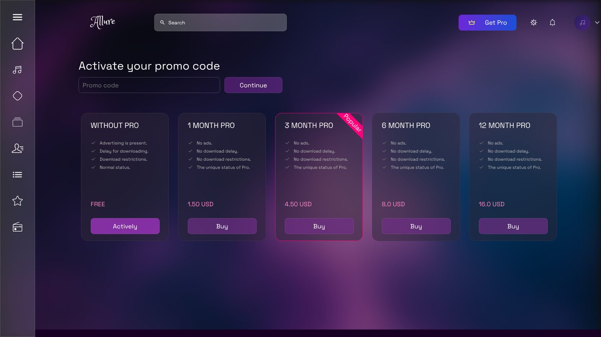 |
| **Admin panel** | |
| 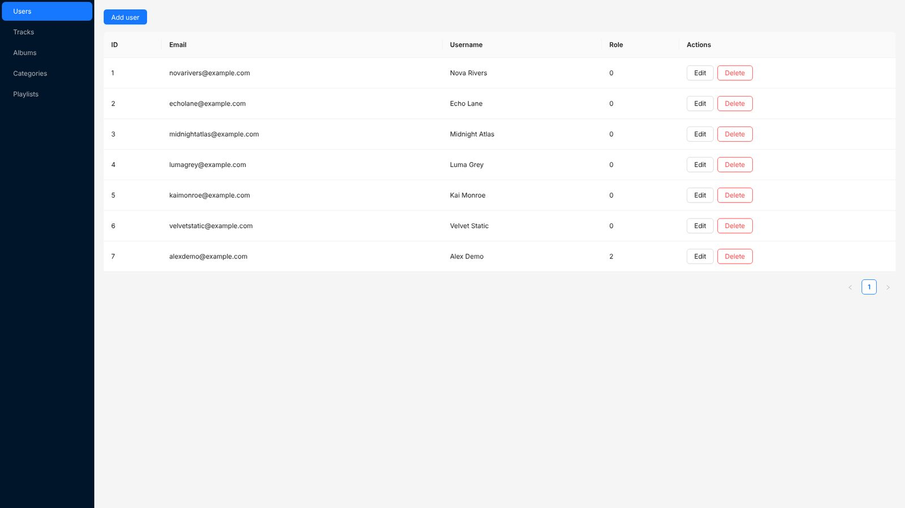 | |

_Screenshots were taken from a local build with generated demo data (users, covers and tracks are placeholders)._

## Tech stack

| Layer | Technologies |
|---|---|
| Frontend | React 19, TypeScript, Vite 6, React Router 7 |
| UI | Tailwind CSS 4, Ant Design 5, FlyonUI, custom CSS from the Figma design |
| State and data | Redux Toolkit (user session), Zustand (player, subscription), TanStack React Query, Axios |
| Auth on the client | JWT in local storage, `@react-oauth/google` |
| Backend | ASP.NET Core Web API on .NET 10 / C# 14 |
| Data access | Entity Framework Core 10 + Npgsql, code-first migrations |
| Database | PostgreSQL |
| Auth on the server | JWT Bearer, Google ID token validation, role-based authorization |
| Validation and docs | FluentValidation, Swagger / OpenAPI (Swashbuckle) |
| Email | SMTP (password recovery) |
| Storage | Local file system (`wwwroot`) for audio, covers, avatars and banners |

## Architecture

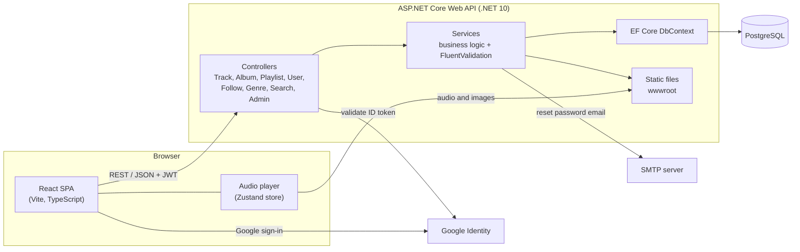

**Request flow.** The SPA calls the REST API through a shared Axios instance that attaches the JWT. Controllers are thin; the logic lives in services behind interfaces (`ITrackService`, `IAlbumService`, …) registered in DI. EF Core maps entities to PostgreSQL. Uploaded audio and images are saved to `wwwroot` and served as static files, so the player streams them directly.

**Data model (main entities).** `User`, `Track`, `Album` (many-to-many with tracks), `Playlist`, `Genre`, `Category`, `Follow`, `TrackLike`, `TrackListen`.

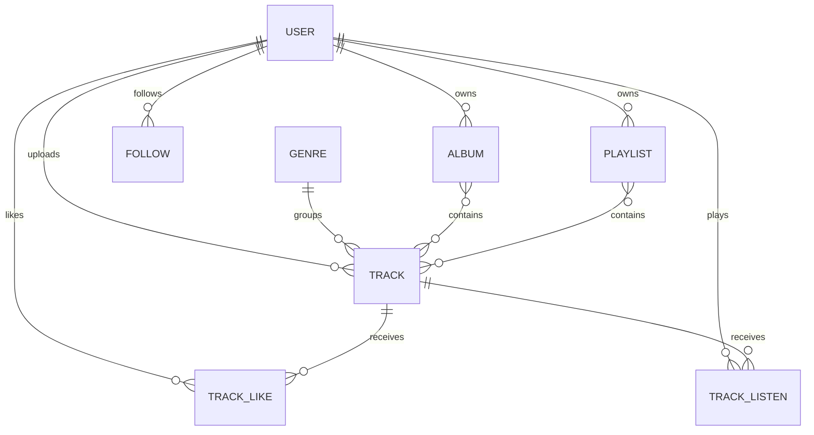

## Repository structure

```
soundcloud-diploma/
├── soundcloud-back/            # ASP.NET Core Web API
│   ├── Controllers/            # REST endpoints
│   ├── Services/               # business logic (interfaces + implementations)
│   ├── Data/                   # DbContext and entities
│   ├── Migrations/             # EF Core migrations
│   ├── Models/                 # DTOs
│   ├── Validators/             # FluentValidation rules
│   ├── Options/, SMTP/         # configuration and email
│   ├── wwwroot/                # uploaded audio and images
│   └── Program.cs              # DI, JWT, CORS, Swagger
├── soundcloud-front/           # React + Vite SPA
│   └── src/
│       ├── components/         # layout, player, shared UI
│       ├── pages/              # route pages (main, detail, profile, admin…)
│       ├── services/           # API clients
│       ├── store/              # Redux + Zustand
│       └── styles/             # CSS
├── docs/screenshots/           # images used in this README
└── soundcloud-dimploma.slnx    # .NET solution
```

More details: [backend README](soundcloud-back/README.md) · [frontend README](soundcloud-front/README.md).

## Getting started

### Prerequisites

- [.NET 10 SDK](https://dotnet.microsoft.com/download)
- [Node.js](https://nodejs.org/) 20 or newer
- [PostgreSQL](https://www.postgresql.org/download/) 14 or newer
- EF Core CLI: `dotnet tool install --global dotnet-ef`

### 1. Clone

```bash
git clone https://github.com/GidXn/soundcloud-diploma.git
cd soundcloud-diploma
```

### 2. Database

Create an empty database (any name; `soundcloud` below):

```bash
createdb -U postgres soundcloud
```

### 3. Backend

Store secrets outside the repository with [user secrets](https://learn.microsoft.com/aspnet/core/security/app-secrets) (or environment variables, see [Configuration](#configuration)):

```bash
cd soundcloud-back
dotnet user-secrets init
dotnet user-secrets set "ConnectionStrings:DefaultConnection" "Host=localhost;Port=5432;Database=soundcloud;Username=postgres;Password=<your-password>"
dotnet user-secrets set "Jwt:Key" "<random string, at least 32 characters>"
dotnet user-secrets set "GoogleAuth:ClientId" "<your-google-client-id>.apps.googleusercontent.com"

dotnet ef database update   # apply migrations
dotnet run                  # API on http://localhost:5122, Swagger at /swagger
```

### 4. Frontend

```bash
cd soundcloud-front
npm install
npm run dev                 # http://localhost:5173
```

Open http://localhost:5173, register an account and upload a first track. To get admin rights locally, change the user's role in the database:

```sql
UPDATE "Users" SET "Role" = 'Admin' WHERE "Email" = 'you@example.com';
```

## Configuration

Backend settings come from `appsettings.json`, user secrets and environment variables (a double underscore `__` replaces `:`).

| Key | Purpose | Example (placeholder) |
|---|---|---|
| `ConnectionStrings:DefaultConnection` | PostgreSQL connection string | `Host=localhost;Database=soundcloud;Username=postgres;Password=…` |
| `Jwt:Key` | JWT signing key (keep secret, 32+ characters) | `change-me-to-a-long-random-string` |
| `Jwt:Issuer` / `Jwt:Audience` | JWT issuer and audience | `soundcloud-api` / `soundcloud-client` |
| `GoogleAuth:ClientId` | Google OAuth client id | `…apps.googleusercontent.com` |
| `Email:FrontendBaseUrl` | Base URL used in password reset links | `http://localhost:5173` |

Frontend (`soundcloud-front/.env.local`):

| Variable | Purpose | Default |
|---|---|---|
| `VITE_BASE_URL` | API base URL | `http://localhost:5122/api` |

The CORS policy in `Program.cs` allows `http://localhost:5173`. Add your domain there before deploying.

## API overview

Full, interactive documentation is available in Swagger at `/swagger` when the API runs in Development.

| Resource | Base route | Highlights |
|---|---|---|
| Users and auth | `/api/User` | register, login, profile, avatar / banner, top users, forgot / reset password |
| Google auth | `/auth/google` | sign in with a Google ID token |
| Tracks | `/api/Track` | upload (`create-file`), list, my tracks, like / unlike, liked, play, stats |
| Albums | `/api/Album` | CRUD, public albums, cover upload, add / remove tracks |
| Playlists | `/api/Playlist` | CRUD, cover upload, add / remove tracks |
| Follow | `/api/Follow` | follow / unfollow, followers, following, counts, status |
| Genres, categories | `/api/Genre`, `/api/Categories` | list for everyone, CRUD for admins |
| Search | `/api/Search` | search and suggestions |
| Admin | `/api/Admin` | users: role, block / unblock, edit, delete; all albums |

## Security notes

> [!WARNING]
> The repository history still contains real credentials that must be **rotated and moved out of the code** before any public deployment:
> - `soundcloud-back/appsettings.json`: the database password in `ConnectionStrings:DefaultConnection` and `Jwt:Key`;
> - `soundcloud-back/SMTP/EmailConfiguration.cs`: SMTP login and password are hard-coded.
>
> Recommended fix: keep placeholders in `appsettings.json`, load real values from user secrets or environment variables, read SMTP settings from the existing `Email` options section, then change the database password, the JWT key and the mail password.

Other things to know: the frontend currently has the API origin `http://localhost:5122` hard-coded in a few places (player, follow API, catalog utils) and the Google client id in `main.tsx`. Both should be moved to `VITE_*` variables for deployment.

## Roadmap

- [ ] Finish the Home page to match the Figma design
- [ ] Responsive layout for tablet and phone
- [ ] CI (build, lint, tests) with GitHub Actions
- [ ] Move all secrets to configuration and rotate them
- [ ] Real radio streams, notifications, user agreement page
- [ ] Deploy a public demo

## Author

<!-- TODO(author): fill in your details -->
**Mykhailo** — _full name, university, group / specialty, year_

- GitHub: [@GidXn](https://github.com/GidXn)
- Contacts: _email / LinkedIn / Telegram (optional)_

Design: Allure UI kit in Figma (_designer credit, if any_).

<!-- TODO(author): choose a license (for example MIT) and add a LICENSE file, or state "All rights reserved" -->
_License: not specified yet._
